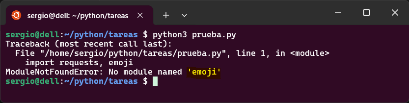
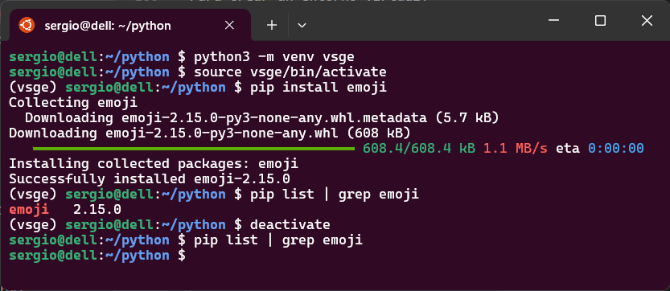

En este apartado nos centraremos en saber qué son los módulos en Python y cómo se utilizan para organizar y reutilizar código. Se explicará cómo importar módulos estándar como `math` o `datetime`, así como cómo crear y utilizar módulos propios. El objetivo es que se comprenda la importancia de dividir el código en partes funcionales y cómo acceder a funciones, clases o variables definidas en otros archivos mediante distintas formas de importación.

Además, se introducirá el uso de paquetes externos mediante el gestor `pip`, que permite instalar librerías desarrolladas por terceros. Se aprenderá a instalar, listar y desinstalar paquetes, así como a utilizar herramientas como `pip freeze` para capturar las dependencias de un proyecto. Se busca que el alumno sea capaz de incorporar nuevas funcionalidades a sus programas sin necesidad de desarrollarlas desde cero, aprovechando el ecosistema abierto de Python.

Por último, se abordará la creación y gestión de entornos virtuales con `venv`, una herramienta fundamental para trabajar en proyectos profesionales. Se aprenderá a crear un entorno aislado, activarlo, instalar paquetes dentro de él y generar un archivo `requirements.txt` para compartir las dependencias. El objetivo es que comprenda cómo evitar conflictos entre proyectos y cómo mantener un entorno limpio y controlado para cada desarrollo.

Básicamente, los contenidos que vamos a abordar en esta sección son:

- Uso de `import`, `from ... import ...`, y alias con `as`.
- Instalación de paquetes con `pip install`.
- Listado y desinstalación de paquetes (`pip list`, `pip uninstall`).
- Creación de entornos virtuales con `venv`.
- Activación y uso de entornos virtuales.
- Archivo `requirements.txt` para compartir dependencias.

## Introducción a los módulos

Un **módulo** en Python es simplemente un archivo `.py` que contiene funciones, clases o variables que pueden ser reutilizadas en otros programas. 

Python incluye muchos **módulos estándar** como `math`, `random` o `datetime`, y también permite crear los tuyos **propios**.

Para poder trabajar con un módulo, en la cabecera del fichero de código lo debemos importar mediante el comando `import`;

!!!example "Importación de módulo `math`"

    ```python
    import math
    print(math.sqrt(25))  # 5.0
    ```

También se puede importar solo una parte del módulo mediante `from <módulo> import <funcion>`:

!!!example "Importación de función `pi` de módulo `math`"

    ```python
    from math import pi
    print(pi)  # 3.141592...
    ```
Observar que en el primer caso para el uso de una función concreta necesitamos indicar `modulo.funcion()` mientras que al importar una función directamente, no es necesario indicar el módulo al que pertenece.

Y también se puede usar alias para acortar nombres de los módulos:

!!!example "Ejemplo de uso de alias para identificar un módulo"

    ```python
    import datetime as dt
    print(dt.datetime.now())
    ```

Por supuestos, python dispone de una serie de módulos de todo tipo que podemos usar, a parte de los que podamos desarrollar o usar de otros desarrolladores.

!!!tip "Información sobre los módulos en Python"

    La fuente más fiable y completa. En ella puedes consultar todos los módulos estándar, sus funciones, clases y ejemplos de uso.

    [https://docs.python.org/es/3/library/index.html](https://docs.python.org/es/3/library/index.html)

    Por ejemplo, si quieres saber qué ofrece el módulo `math`, puedes ir directamente a:

    [https://docs.python.org/es/3/library/math.html](https://docs.python.org/es/3/library/math.html)


## Uso de módulos propios en Python

Como programadores, podemos crear módulos (archivos) donde definimos funciones que después vamos a reutilizar en nuestro/s proyectos. 

Cuando tenemos funciones definidas en un archivo como `utils.py`, podemos reutilizarlas en otros archivos del mismo proyecto importándolas. No es necesario hacer nada especial para “exportarlas”: basta con que estén definidas correctamente y que el archivo esté en la misma carpeta (o en una ruta accesible).

Por ejemplo, veamos el caso de si tenemos un fichero para módulos y otro principal

!!!example "Uso de módulos propios"

    Supongamos que tenemos esta estructura:

    ```plaintext
    mi_proyecto/
    ├── utils.py
    └── main.py
    ```

    Y en `utils.py` tenemos:

    ```python
    def saludar(nombre):
        return f"Hola, {nombre}!"

    def sumar(a, b):
        return a + b
    ```

    Entonces en `main.py` podemos importar estas funciones así:

    ```python
    from utils import saludar, sumar

    print(saludar("Sergio"))
    print(sumar(3, 5))
    ```

    También podemos importar todo el módulo completo:

    ```python
    import utils

    print(utils.saludar("Lucía"))
    print(utils.sumar(10, 7))
    ```

Ambas formas son válidas. La primera importa funciones específicas, la segunda importa el módulo completo.

### 🧩 Ejemplo y ejercicio de uso

Veamos el siguiente ejemplo

!!!example "Ejemplo de uso de módulos propios"

    **Archivo `utils.py`**

    ```python
    def convertir_mayusculas(texto):
        return texto.upper()

    def obtener_longitud(texto):
        return len(texto)
    ```

    **Archivo `main.py`**

    ```python
    from utils import convertir_mayusculas, obtener_longitud

    frase = "Hola desde Alberic"
    print(convertir_mayusculas(frase))       # HOLA DESDE ALBERIC
    print(obtener_longitud(frase))           # 18
    ```

Este ejemplo muestra cómo separar funciones en un módulo y usarlas desde otro archivo.

!!!question "Ejercicio: Crear módulo de utilidades y usarlo desde otro archivo"

    Crea un archivo llamado `utils.py` que contenga las siguientes funciones:

    - `es_par(n)`: devuelve `True` si el número es par.
    - `formatear_nombre(nombre)`: devuelve el nombre con la primera letra en mayúscula y el resto en minúscula.

    Luego crea otro archivo llamado `main.py` que:

    1. Importe las funciones desde `utils.py`.
    2. Pida al usuario un número y un nombre.
    3. Muestre si el número es par.
    4. Muestre el nombre formateado.

    > Pistas  
    > - Usa `input()` para recoger datos.  
    > - Usa `from utils import ...` para importar funciones.  
    > - Usa `int()` para convertir el número.
    > - Calcula el resto para saber si es por o no y utiliza la funcion `texto.capitaliza()` para pasar solo la primera letra a mayusculas  

    ???quote "Solución"

        **Archivo `utils.py`**

        ```python
        def es_par(n):
            return n % 2 == 0

        def formatear_nombre(nombre):
            return nombre.capitalize()
        ```

        **Archivo `main.py`**

        ```python
        from utils import es_par, formatear_nombre

        numero = int(input("Introduce un número: "))
        nombre = input("Introduce tu nombre: ")

        if es_par(numero):
            print("El número es par.")
        else:
            print("El número es impar.")

        print("Nombre formateado:", formatear_nombre(nombre))
        ```


## Instalación de paquetes con `pip`

**`pip`** es el gestor de paquetes oficial de Python. Permite instalar librerías externas que no vienen incluidas por defecto. Por ejemplo, para instalar la librería `requests`:

```bash
pip install requests
```

Una vez instalada, puedes usarla en tu código:

!!!example "Ejemplo de uso de librería `request`"

    ```python
    import requests
    respuesta = requests.get("https://www.google.com")
    print(respuesta.status_code)
    ```

Si intentamos hacer el `import` de un paquete no instalado en el sistema, entonces tendremos un error.

<figure markdown="span" align="center">
  { width="75%"  }
  <figcaption>Error por falta de librería "emoji"</figcaption>
</figure>

Para ver qué paquetes tienes instalados:

```bash
pip list
```

Para desinstalar uno:

```bash
pip uninstall <<nombre_paquete>>
```

---

## Entornos virtuales

Un **entorno virtual** es una carpeta aislada que contiene su propia instalación de Python y sus propios paquetes. Esto evita conflictos entre proyectos y permite mantener cada uno con sus dependencias específicas.

Esto nos permite crear aplicaciones y tener instalados todos los paquetes de forma aislada, de forma que los paquetes de una aplicación no interfieren con los de otra. Esto puede parecer trivial, pero no lo es, puesto que podemos usar diferentes versiones de paquetes en aplicaciones diferentes.

Para crear un entorno virtual:

```bash
python -m venv mi_entorno
```

Esto crea una carpeta llamada `mi_entorno`. Para activarlo:

- En Windows:
  ```dos
  mi_entorno\Scripts\activate
  ```
- En macOS/Linux:
  ```bash
  source mi_entorno/bin/activate
  ```

Una vez activado, puedes instalar paquetes con `pip` y quedarán guardados solo en ese entorno.

Para salir del entorno:

```bash
deactivate
```

Veamos un ejemplo que clarificará cómo se aplica:

<figure markdown="span" align="center">
  { width="75%"  }
  <figcaption>Entorno Virtual en Python</figcaption>
</figure>

En el ejemplo anterior podemos ver los siguientes pasos:

1. Se crea un entorno virtual `vsge` y se activa
2. Se instala el paquete `emogi`
3. Se comprueba que el paquete esta instalado
4. Se sale del entorno virtual
5. Se comprueba que el paquete `emogi` no esta instalado, por lo que se demuestra que solo queda instalado si se utiliza con el entorno activo.


### Trabajando con entornos virtuales y organización de módulos

La forma más aconsejable y profesional de organizar un proyecto con entorno virtual es **trabajar en una carpeta base del proyecto** y tener el entorno virtual como una **subcarpeta dentro de ella**. Esto permite mantener el código fuente, los archivos de configuración, los datos y el entorno virtual **bien separados y estructurados**, lo que facilita el mantenimiento, la colaboración y el despliegue.

Además, cuando el proyecto crece, es habitual agrupar funciones propias en **subcarpetas** que actúan como paquetes. Esto mejora la modularidad y permite importar funciones desde distintos archivos sin mezclar todo en un único módulo. Para que una subcarpeta sea tratada como paquete, debe contener un archivo `__init__.py`, aunque esté vacío.

!!!note "El fichero `__init__.py`"

    El archivo `__init__.py` indica que una carpeta debe ser tratada como un paquete de Python. Aunque en versiones modernas ya no es obligatorio, sigue siendo una buena práctica incluirlo.
    
    Aunque el archivo `__init__.py` puede estar vacío, también puede incluir **código útil de inicialización** para el paquete. Esto permite controlar qué funciones, clases o submódulos se exponen al importar el paquete, definir constantes globales, o incluso agrupar accesos para simplificar el uso desde fuera.

    Por ejemplo, si tienes varios módulos en la carpeta `utilidades/`, puedes usar `__init__.py` para importar funciones clave y facilitar el acceso desde el exterior:

    ```python
    # utilidades/__init__.py
    from .texto import formatear_mensaje
    from .numeros import es_par
    ```

    Esto permite que desde `main.py` puedas hacer:

    ```python
    from utilidades import formatear_mensaje, es_par
    ```

    En lugar de tener que importar cada módulo por separado. 
    
    También puedes definir constantes o funciones que se ejecuten al cargar el paquete:

    ```python
    # utilidades/__init__.py
    VERSION = "1.0"

    def iniciar():
        print("Paquete utilidades cargado correctamente.")
    ```

    Después estas funciones o constantes las puedes utilizar desde cualquier parte:

    ```python
    import utilidades

    utilidades.iniciar() 
    ```

    Este enfoque es útil cuando quieres que el paquete tenga un comportamiento inicial o una configuración común.

De hecho, podemos decir que tenemos una estructura base típica a la hora de crear un proyecto en Python que sería similar a la mostrada en el siguiente ejemplo:

!!!example "Estructura recomendada"

    ```plaintext
    mi_proyecto/
    ├── venv/                     ← entorno virtual (subcarpeta)
    ├── main.py                   ← código principal
    ├── utilidades/              ← paquete con módulos propios
    │   ├── __init__.py          ← indica que es un paquete
    │   └── texto.py             ← módulo con funciones de texto
    ├── requirements.txt         ← dependencias del proyecto
    ├── README.md                ← documentación
    └── datos/                   ← archivos de entrada/salida
    ```

Esta estructura permite que el entorno virtual esté contenido dentro del proyecto, pero **no mezclado con el código**. También facilita que puedas subir tu proyecto a GitHub o compartirlo sin incluir el entorno virtual (que suele añadirse al `.gitignore`). Al mismo tiempo, el uso de paquetes como `utilidades/` permite mantener el código organizado y reutilizable.

!!!tip "Ejemplo de invocación de funciones desde un módulo en subcarpeta"

    Si tienes una función `formatear_mensaje()` definida en `utilidades/texto.py`, puedes usarla desde `main.py` así:

    ```python
    from utilidades.texto import formatear_mensaje

    print(formatear_mensaje("hola desde Valencia"))
    ```

    Recuerda que la carpeta `utilidades` debe contener un archivo `__init__.py` para que Python la reconozca como paquete.

En el siguiente apartado hablaremos el archivo `requirements.txt`

### Usos típicos de los entornos virtuales

Un entorno virtual no es solo para instalar paquetes. También te permite:

- **Usar una versión específica de Python** (si lo creas con `pyenv` o herramientas similares).
- **Ejecutar scripts con dependencias aisladas**, sin interferencias de otros proyectos.
- **Probar diferentes versiones de librerías** sin afectar tu sistema.
- **Instalar herramientas de desarrollo** como linters, formateadores o frameworks sin contaminar el entorno global.

O sea, el entorno virtual es como una “burbuja” donde puedes trabajar con total libertad, sabiendo que todo lo que instales o configures queda dentro de esa carpeta.


## Archivo `requirements.txt`

Este archivo contiene la lista de paquetes necesarios para un proyecto. Se puede generar automáticamente:

```bash
pip freeze > requirements.txt
```

Y se puede usar para instalar todos los paquetes en otro entorno:

```bash
pip install -r requirements.txt
```

Esto es muy útil para compartir proyectos con otros desarrolladores o para desplegar en servidores. En vez de estar instalando manualmente todos los paquetes, mediante este fichero el servidor sabe qué paquetes debe instalar (automáticamente).


!!!note "Instalación automática en despliegues"

    En ejecución local, Python **no instala automáticamente** los paquetes aunque estén en `requirements.txt`. Pero en entornos de despliegue sí se automatiza:

    - **Docker**
    ```dockerfile
    COPY requirements.txt .
    RUN pip install -r requirements.txt
    ```

    - Plataformas como **Heroku** o **GitHub Actions**
    Detectan el fichero y ejecutan automáticamente:
    ```bash
    pip install -r requirements.txt
    ```

    - **Script de arranque personalizado**
    ```bash
    pip install -r requirements.txt && python main.py
    ```


## 🧩 Ejemplo y ejercicio de uso

El siguiente ejemplo permite crear un flujo que prepara un proyecto web con *Flask* sin afectar otros proyectos.

!!!example "Ejemplo de uso"

    Los siguiente pasos crean en entorno virtual, lo activa, instala el paquete flask y genera el fichero requirements.txt

    ```bash
    # Crear entorno virtual
    python -m venv entorno_web

    # Activar entorno (Windows)
    entorno_web/Scripts/activate

    # Instalar Flask
    pip install flask

    # Guardar dependencias
    pip freeze > requirements.txt

    # Desactivar entorno
    deactivate
    ```

!!!question "Ejercicio: Preparar entorno para proyecto de análisis de datos"

    Imagina que vas a empezar un proyecto de análisis de datos en Python.  
    Crea un entorno virtual llamado `analisis`, instala los paquetes `pandas` y `matplotlib`, y guarda las dependencias en un archivo `requirements.txt`.

    > Pistas  
    > - Usa `python -m venv` para crear el entorno.  
    > - Activa el entorno antes de instalar los paquetes.  
    > - Usa `pip freeze` para generar el archivo.

    ???quote "Solución"

        ```bash
        # Crear entorno virtual
        python -m venv analisis

        # Activar entorno (Windows)
        analisis/Scripts/activate

        # Instalar paquetes
        pip install pandas matplotlib

        # Guardar dependencias
        pip freeze > requirements.txt

        # Desactivar entorno
        deactivate
        ```

---

## Apéndice: Módulos comunes

A continuación se presentan algunos módulos externos populares en Python, con su utilidad y ejemplos de funciones clave. 

Lor primeros viene incluidos dentro de la propia instalacion de Python:

=== "json"
    **Utilidad**: Trabajar con datos en formato JSON (muy usado en APIs y persistencia).

    **Funciones destacadas**:

    - `dump(obj, file)`: Guarda un objeto Python en un fichero `.json`.
    - `load(file)`: Carga datos desde un fichero `.json`.
    - `dumps(obj)`: Convierte un objeto Python a cadena JSON.
    - `loads(str)`: Convierte una cadena JSON a objeto Python.

    **Ejemplo**:
    ```python
    import json

    datos = {"nombre": "Ana", "edad": 30}
    cadena = json.dumps(datos)
    print(cadena)
    ```

=== "datetime"
    **Utilidad**: Gestionar fechas, horas y diferencias temporales.

    **Funciones destacadas**:

    - `datetime.now()`: Fecha y hora actual.
    - `datetime.strptime()`: Convertir cadena a fecha.
    - `timedelta`: Representa una duración.
    - `date.today()`: Fecha actual sin hora.

    **Ejemplo**:
    ```python
    from datetime import datetime
    ahora = datetime.now()
    print(ahora.strftime("%d/%m/%Y %H:%M"))
    ```

=== "os"
    **Utilidad**: Interactuar con el sistema operativo (rutas, entorno, procesos).

    **Funciones destacadas**:

    - `os.getcwd()`: Directorio actual.
    - `os.listdir()`: Archivos en una carpeta.
    - `os.path.join()`: Unir rutas.
    - `os.environ`: Variables de entorno.

    **Ejemplo**:
    ```python
    import os
    print("Carpeta actual:", os.getcwd())
    ```

=== "sys"
    **Utilidad**: Acceder a parámetros del sistema y controlar la ejecución.

    **Funciones destacadas**:

    - `sys.argv`: Argumentos pasados al script.
    - `sys.exit()`: Finaliza el programa.
    - `sys.path`: Rutas de búsqueda de módulos.

    **Ejemplo**:
    ```python
    import sys
    print("Argumentos:", sys.argv)
    ```

=== "random"
    **Utilidad**: Generar números aleatorios y seleccionar elementos.

    **Funciones destacadas**:

    - `random.randint(a, b)`: Entero aleatorio entre `a` y `b`.
    - `random.choice(lista)`: Elemento aleatorio.
    - `random.shuffle(lista)`: Mezcla la lista.
    - `random.random()`: Número decimal entre 0 y 1.

    **Ejemplo**:  
    ```python
    import random
    print("Número aleatorio:", random.randint(1, 10))
    ```

=== "math"
    **Utilidad**: Operaciones matemáticas básicas y avanzadas.

    **Funciones destacadas**:

    - `math.sqrt(x)`: Raíz cuadrada.
    - `math.pow(x, y)`: Potencia.
    - `math.floor(x)`: Redondeo hacia abajo.
    - `math.pi`: Constante π.

    **Ejemplo**:
    ```python
    import math
    print("Raíz de 25:", math.sqrt(25))
    ```

=== "time"
    **Utilidad**: Medir tiempos, pausas y temporizadores.

    **Funciones destacadas**:

    - `time.sleep(segundos)`: Pausa.
    - `time.time()`: Timestamp actual.
    - `time.strftime()`: Formatear fecha/hora.

    **Ejemplo**:
    ```python
    import time
    print("Inicio")
    time.sleep(2)
    print("Fin tras 2 segundos")
    ```


Y ahora otros que necesitan ser instalados usando `pip`

```bash
pip install nombre_del_paquete
```

=== "requests"
    **Utilidad**: Realiza peticiones HTTP.

    **Funciones destacadas**:

    - `get(url)`: Realiza una petición GET.
    - `post(url, data)`: Envía datos con POST.
    - `json()`: Convierte la respuesta en diccionario.
    - `status_code`: Código de estado HTTP.

    **Ejemplo**:
    ```python
    import requests
    r = requests.get("https://api.github.com")
    print(r.status_code)
    print(r.json())
    ```

=== "pytest"
    **Utilidad**: Automatiza pruebas unitarias.

    **Funciones destacadas**:

    - `assert`: Verifica condiciones esperadas.
    - `raises`: Comprueba excepciones.
    - `fixture`: Prepara contexto de prueba.
    - `mark.parametrize`: Ejecuta con múltiples valores.

    **Ejemplo**:
    ```python
    def suma(a, b): return a + b

    def test_suma():
        assert suma(2, 3) == 5
    ```

=== "pandas"
    **Utilidad**: Manipula datos tabulares.

    **Funciones destacadas**:

    - `read_csv()`: Carga datos desde CSV.
    - `head()`: Primeras filas.
    - `describe()`: Estadísticas básicas.
    - `groupby()`: Agrupación por columna.

    **Ejemplo**:
    ```python
    import pandas as pd
    df = pd.read_csv("datos.csv")
    print(df.describe())
    ```

=== "matplotlib"
    **Utilidad**: Genera gráficos 2D.

    **Funciones destacadas**:

    - `plot()`: Línea simple.
    - `bar()`: Barras.
    - `scatter()`: Dispersión.
    - `hist()`: Histograma.
    - `show()`: Muestra el gráfico.

    **Ejemplo**:
    ```python
    import matplotlib.pyplot as plt
    plt.plot([1, 2, 3], [4, 1, 7])
    plt.title("Gráfico de ejemplo")
    plt.show()
    ```

=== "numpy"
    **Utilidad**: Cálculo numérico con arrays.

    **Funciones destacadas**:

    - `array()`: Crea un array.
    - `mean()`: Media.
    - `reshape()`: Cambia forma.
    - `dot()`: Producto matricial.
    - `random.rand()`: Array aleatorio.

    **Ejemplo**:
    ```python
    import numpy as np
    a = np.array([1, 2, 3])
    print(np.mean(a))
    ```

=== "flask"
    **Utilidad**: Aplicaciones web ligeras.

    **Funciones destacadas**:

    - `Flask()`: Crea la app.
    - `route()`: Define rutas.
    - `render_template()`: Usa HTML.
    - `request`: Accede a datos enviados.

    **Ejemplo**:
    ```python
    from flask import Flask
    app = Flask(__name__)

    @app.route("/")
    def inicio():
        return "Hola desde Flask"
    ```

=== "colorama"
    **Utilidad**: Colorea texto en terminal.

    **Funciones destacadas**:

    - `Fore`: Colores de texto.
    - `Back`: Colores de fondo.
    - `Style`: Estilos como negrita.
    - `init()`: Inicializa colorama.

    **Ejemplo**:
    ```python
    from colorama import Fore, Style
    print(Fore.RED + Style.BRIGHT + "Error crítico")
    ```

=== "emoji"
    **Utilidad**: Muestra emojis en texto.

    **Funciones destacadas**:

    - `emojize()`: Convierte texto en emoji.
    - `demojize()`: Convierte emoji en texto.
    - `replace_emoji()`: Sustituye emojis.

    **Ejemplo**:
    ```python
    import emoji
    print(emoji.emojize("Python es divertido :snake:"))
    ```

=== "bcrypt"
    **Utilidad**: Cifrado seguro de contraseñas.

    **Funciones destacadas**:

    - `hashpw()`: Cifra una contraseña.
    - `gensalt()`: Genera sal aleatoria.
    - `checkpw()`: Verifica contraseña.

    **Ejemplo**:
    ```python
    import bcrypt
    clave = b"secreta123"
    hashed = bcrypt.hashpw(clave, bcrypt.gensalt())
    print(bcrypt.checkpw(clave, hashed))
    ```

=== "python-dotenv"
    **Utilidad**: Carga variables desde `.env`.

    **Funciones destacadas**:

    - `load_dotenv()`: Carga las variables.
    - `dotenv_values()`: Devuelve diccionario.
    - `find_dotenv()`: Localiza el fichero `.env`.

    **Ejemplo**:
    ```python
    from dotenv import load_dotenv
    import os

    load_dotenv()
    print(os.getenv("API_KEY"))
    ```


