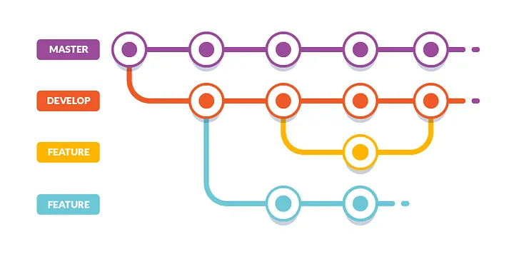
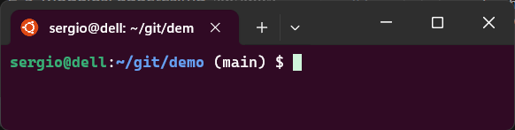
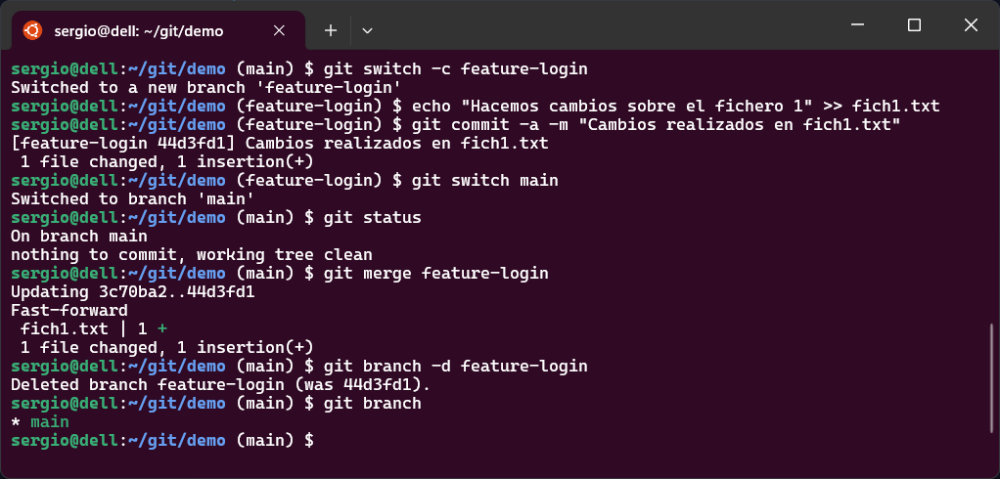

Trabajar con ramas es una de las ventajas más potentes de Git: te permite desarrollar funcionalidades, corregir errores o experimentar sin afectar la rama principal.

## Concepto de rama

- Una rama (*branch*) es simplemente un puntero que apunta a un commit.
- La rama principal suele llamarse `main` o `master` (aunque puedes cambiar el nombre).
- Cuando creas una rama nueva, Git crea un nuevo puntero que “se mueve” a medida que haces commits en esa rama.

Imagina una línea de tiempo:

<figure markdown="span" align="center">
  { width="85%"  }
  <figcaption>Ramas locales en git.</figcaption>
</figure>

En este gráfico podemos ver que podemos tener varias ramas en nuestro proyecto que al mismo tiempo pueden volver a ramificarse en otras ramas y volver a unirse.


!!!tip "Mostrar la rama actual de Git en el *prompt* de Linux"

    Cuando trabajamos con varios proyectos y ramas, es muy útil que el *prompt* de la terminal muestre en qué rama de Git estamos.  
    Puede ser muy interesante aplicar este truco antes de trabajar con ramas.

    Veamos los pasos para activar el *prompt* de Git

    1. Abre tu archivo `~/.bashrc` y añade esta función **antes** de definir el `PS1`:

        ```bash
        parse_git_branch() {
          git rev-parse --is-inside-work-tree &>/dev/null || return
          branch=$(git symbolic-ref --short HEAD 2>/dev/null)
          [ -n "$branch" ] && echo "($branch)"
        }
        ```

    2. Modificar el prompt (`PS1`). Justo después, modifica la línea que define `PS1`. Por ejemplo:

        ```bash
        PS1='\u@\h:\w $(parse_git_branch)\$ '
        ```

    3. Guarda los cambios y recarga el archivo:

        ```bash
        source ~/.bashrc
        ```
    Tendrán un resultado similar al siguiente, donde verás entre parentesis en qué rama te encuentras.

    <figure markdown="span" align="center">
      { width="80%"  }
    </figure>

!!!note "Ventajas de usar ramas"
    - Trabajo aislado: puedes trabajar en nuevas funcionalidades sin afectar el código estable.
    - Experimentación: puedes probar ideas nuevas sin miedo.
    - Colaboración: cada desarrollador puede tener su rama y luego fusionar al proyecto principal.

## Comandos de ramas

| Comando | Qué hace |
|---|---|
| `git branch nombre_rama`  |  Crea una rama llamada `nombre_rama` (no cambia a ella, solo la crea). |
| `git switch nombre_rama`  |  Cambia la rama activa a `nombre_rama` (antes era `git checkout nombre_rama`). |
| `git switch -c nombre_rama` |  Crea y cambia a la rama nueva en un solo paso. |
| `git branch` | Muestra ramas de repositorio actual |
| `git show-branch` | Muestra ramas de repositorio actual de una forma pseudo gráfica. |
| `git branch -d nombre_rama`  |  Elimina la rama local `nombre_rama` **solo si ya ha sido fusionada**; si no, Git se niega a borrarla. |
| `git branch -D nombre_rama`  |  Fuerza el borrado de la rama aunque **no** esté fusionada (se pierden sus commits no fusionados). |
| `git merge` | Combina cambios de otra rama en la actual |
| `git diff` | Muestra los cambios sin confirmar. Con dos ramas (`git diff rama1 rama2`) muestra las diferencias entre ellas. |
| *Fast-forward merge* | Cuando la rama actual puede avanzar sin conflictos |
| *Commit de merge* | Se crea cuando hay líneas de desarrollo paralelas |


### Crear y cambiar ramas
```bash
git branch nueva-rama
git switch nueva-rama
```
o también en un único paso

```bash
git switch -c nueva-rama
```

!!!note "git switch vs git checkout"

    En Git, `git switch` es el comando moderno y recomendado para cambiar de rama, mientras que `git checkout` es el comando más antiguo que también permite hacerlo, pero con funciones adicionales que pueden generar confusión. 


### Fusionar ramas
```bash
git merge rama-a-fusionar
```

### Eliminar ramas
```bash
git branch -d nombre-rama
```
Solo borra la rama si sus cambios ya están fusionados en la rama actual; si no, Git avisa y no la elimina, para evitar perder trabajo.

!!!warning "Borrado forzado: `-D`"

    ```bash
    git branch -D nombre-rama
    ```

    Borra la rama **aunque no esté fusionada**. Los commits que solo existían en esa rama quedan inaccesibles. Úsalo únicamente cuando estés seguro de que no necesitas ese trabajo.

### Ver diferencias
```bash
git diff
```
Muestra los cambios no confirmados (los que están en el directorio de trabajo y aún no se han añadido con `git add`).

```bash
git diff --staged
```
Muestra los cambios que ya están en el área de preparación, pendientes del próximo commit.

```bash
git diff main login
```
Muestra las diferencias entre dos ramas.

### Ver ramas 
```bash
git branch
```
Muestra las ramas que tiene el repositorio.


## Flujo típico con ramas

1. Estás en la rama principal `main`.
2. Creas una rama para tratar una nueva funcionalidad:
   ```
   git switch -c feature-login
   ```
3. Trabajas, haces commits en `feature-login`.
4. Cuando esté lista la funcionalidad, cambias de nuevo a `main`:
   ```
   git switch main
   ```
5. Fusionas (merge) la rama:
   ```
   git merge feature-login
   ```
6. Si quieres, borras la rama `feature-login`:
   ```
   git branch -d feature-login
   ```

<figure markdown="span" align="center">
  { width="85%"  }
  <figcaption>Ejemplo de trabajo con ramas.</figcaption>
</figure>

### Fusiones (`merge`) y conflictos

- `git merge rama_origen` fusiona los cambios de la rama indicada en la rama actual.
- Si los cambios no se solapan, el merge es automático (fast-forward o commit de merge).
- Si hay conflictos, Git te avisará y tendrás que resolverlos manualmente.
- Después de resolver conflictos, haces `git add` de los archivos modificados y luego `git commit`.


### Ejemplo práctico: creación, trabajo y fusión de ramas en Git

Este ejemplo muestra paso a paso cómo trabajar con ramas en Git utilizando un ejemplo sencillo.
Incluye comandos, explicaciones y esquemas gráficos para visualizar la evolución del repositorio.

#### Crear el repositorio inicial

```bash
# Creamos una carpeta y entramos
mkdir demo-git
cd demo-git

# Inicializamos el repositorio Git
git init

# Creamos un archivo inicial
echo "Proyecto base" > README.md
git add README.md
git commit -m "Commit inicial con README"
```

**Estado del repositorio:**

```
A ← main
```

*(Solo existe la rama `main`, con un único commit “A”)*

!!!tip "¿`main` o `master`?"

    Según la versión de Git y su configuración, `git init` puede crear la rama principal con el nombre `master`. Si ese es tu caso, renómbrala antes de seguir con `git branch -M main` (o configura `git config --global init.defaultBranch main` para los repositorios futuros).


#### Crear la rama `login` y trabajar en ella

```bash
# Crear y cambiar a la rama 'login'
git switch -c login

# Simulamos una modificación
echo "Funcionalidad login" > login.py
git add login.py
git commit -m "Añadido módulo login"
```

**Estructura actual:**

```
A ← main
 \
  B ← login
```

#### Crear otra rama `perfil` desde `main`

Primero volvemos a la rama principal y creamos otra:

```bash
git switch main
git switch -c perfil
echo "Funcionalidad perfil de usuario" > perfil.py
git add perfil.py
git commit -m "Añadido módulo perfil de usuario"
```

**Estructura actual:**

```
A ← main
 ├── B ← login
 └── C ← perfil
```

*(Cada rama tiene un nuevo commit diferente partiendo del mismo punto A.)*


#### Fusionar la rama `login` en `main`

Volvemos a `main` y fusionamos los cambios de `login`:

```bash
git switch main
git merge login
```

**Después del merge:**

```
A — B ← main, login
 \
  C ← perfil
```

- La rama `main` ahora incluye los cambios de `login`.  
- Si no hay conflictos, Git hace un *fast-forward merge* (mueve el puntero `main` al commit B).  


#### Fusionar la rama `perfil`

Ahora fusionamos la segunda rama:

```bash
git merge perfil
```

**Resultado (merge normal):**

```
A — B — M ← main
 \     /
  C ——┘ ← perfil
```

- `M` es un **commit de merge** que combina el trabajo de las dos ramas: tiene **dos padres** (`B` y `C`).  
- `login` sigue apuntando a `B` y `perfil` a `C`; ambas se unen en `M`.  

#### Limpiar ramas ya fusionadas

```bash
git branch -d login
git branch -d perfil
```

**Resultado final:**

```
A — B — M ← main
 \     /
  C ——┘
```

*(El proyecto tiene la funcionalidad de `login` y `perfil` integradas en la rama principal. Al borrar las ramas solo desaparecen las etiquetas: los commits `B` y `C` siguen en el historial y se pueden ver con `git log --graph`.)*


## Resolución de conflictos en un merge

Un **conflicto** aparece cuando Git no puede decidir por sí solo cómo combinar los cambios de dos ramas. Es una situación normal en el trabajo con ramas, no un error grave.

Se produce, por ejemplo, cuando:

- Las dos ramas han modificado **las mismas líneas** de un mismo fichero (con contenido distinto).
- Una rama **modifica** un fichero y la otra lo **elimina**.

Si las dos ramas modifican el mismo fichero pero en **zonas distintas**, Git lo fusiona automáticamente y no hay conflicto.

!!!note "Un conflicto no rompe nada"

    Mientras estás resolviendo un conflicto, el merge está **a medias** y el historial no se ha modificado todavía. Puedes cancelar el proceso en cualquier momento con `git merge --abort` y volver al estado anterior al `git merge`.

### Escenario de ejemplo

Partimos del repositorio `demo-git` del ejemplo anterior, con el fichero `README.md` que contiene `Proyecto base`. Vamos a modificar **la misma línea** en dos ramas distintas.

```bash
# Rama 'docs': cambiamos la primera línea del README
git switch -c docs
echo "Proyecto base - documentación" > README.md
git add README.md
git commit -m "README: añadida referencia a documentación"

# Volvemos a main y cambiamos esa misma línea de otra forma
git switch main
echo "Proyecto base - versión 1.0" > README.md
git add README.md
git commit -m "README: indicada versión 1.0"
```

**Estructura actual** (las dos ramas parten del mismo commit y han modificado la misma línea):

```
      B ← docs
     /
A ——┤
     \
      C ← main (HEAD)
```

!!!tip "Antes de hacer un merge"

    Comprueba con `git status` que el directorio de trabajo está limpio (sin cambios sin confirmar). Si no, Git puede negarse a hacer el merge o mezclar cambios pendientes con los del conflicto, y será mucho más difícil de resolver.

### Pasos para resolver un conflicto

#### 1. Lanzar el merge y detectar el conflicto

Estando en la rama que **recibe** los cambios (`main`), fusionamos la otra:

```bash
git merge docs
```

Git avisa de que no ha podido completar la fusión:

```
Auto-merging README.md
CONFLICT (content): Merge conflict in README.md
Automatic merge failed; fix conflicts and then commit the result.
```

*(Si tu sistema está en español, los mensajes aparecerán traducidos.)*

#### 2. Identificar los ficheros en conflicto

```bash
git status
```

```
On branch main
You have unmerged paths.
  (fix conflicts and run "git commit")
  (use "git merge --abort" to abort the merge)

Unmerged paths:
  (use "git add <file>..." to mark resolution)
        both modified:   README.md
```

Los ficheros listados en **Unmerged paths** (`both modified`) son los que debemos resolver. El resto de ficheros que se hayan podido fusionar sin problema ya están en el *staging*.

#### 3. Abrir el fichero e interpretar los marcadores

Git ha modificado `README.md` e insertado **marcadores de conflicto** en él:

```
<<<<<<< HEAD
Proyecto base - versión 1.0
=======
Proyecto base - documentación
>>>>>>> docs
```

| Marcador | Significado |
|---|---|
| `<<<<<<< HEAD` | Inicio del conflicto. Lo que hay debajo es la versión de la **rama actual** (`main`). |
| `=======` | Separador entre las dos versiones. |
| `>>>>>>> docs` | Fin del conflicto. Lo que hay encima es la versión de la **rama que se fusiona** (`docs`). |

#### 4. Editar el fichero y decidir el resultado final

Debemos dejar el fichero **exactamente como queremos que quede**, y eso implica **eliminar los tres marcadores** (`<<<<<<<`, `=======`, `>>>>>>>`). Tenemos tres opciones:

- Quedarnos con la versión de la rama actual.
- Quedarnos con la versión de la otra rama.
- **Combinar** ambas versiones (lo más habitual), o escribir algo nuevo.

Por ejemplo, combinando ambas:

```
Proyecto base - versión 1.0 - documentación
```

!!!warning "Elimina siempre los marcadores"

    Si olvidas borrar alguna línea `<<<<<<<`, `=======` o `>>>>>>>`, Git no te lo impedirá y el fichero quedará con esos símbolos dentro (en código fuente, además, dejará de compilar o ejecutarse). Puedes comprobar que no queda ninguno con:

    ```bash
    grep -rn "<<<<<<<\|>>>>>>>" .
    ```

#### 5. Marcar el conflicto como resuelto

Con `git add` le indicamos a Git que el fichero ya está resuelto:

```bash
git add README.md
git status
```

El fichero pasará de `Unmerged paths` a `Changes to be committed`. Hay que repetir los pasos 3, 4 y 5 **por cada fichero en conflicto**.

#### 6. Finalizar el merge con un commit

```bash
git commit
```

Git abrirá el editor con un mensaje por defecto (`Merge branch 'docs'`) que puedes aceptar o personalizar. También se puede indicar directamente:

```bash
git commit -m "Merge de docs en main: resuelto conflicto en README.md"
```

#### 7. Verificar el resultado

```bash
git log --oneline --graph
```

```
*   e4f5a6b (HEAD -> main) Merge de docs en main: resuelto conflicto en README.md
|\
| * b2c3d4e (docs) README: añadida referencia a documentación
* | a1b2c3d README: indicada versión 1.0
|/
* 9f8e7d6 Commit inicial con README
```

*(Los identificadores de commit serán distintos en tu repositorio.)*

**Estructura final:**

```
      B ← docs
     /   \
A ——┤     M ← main
     \   /
      C
```

`M` es el **commit de merge** que recoge la solución del conflicto. Si ya no necesitas la rama, puedes eliminarla con `git branch -d docs`.

### Otras opciones durante un conflicto

| Comando | Qué hace |
|---|---|
| `git merge --abort` | Cancela el merge y devuelve el repositorio al estado anterior. |
| `git restore --ours fichero` | Descarta la versión de la otra rama y deja la de la rama actual (`main`). Después hay que hacer `git add`. |
| `git restore --theirs fichero` | Descarta la versión de la rama actual y deja la de la otra rama (`docs`). Después hay que hacer `git add`. |
| `git diff` | Durante un conflicto muestra las diferencias que aún están sin resolver. |
| `git mergetool` | Abre una herramienta gráfica de fusión (si está configurada). |

!!!tip "Resolver conflictos desde el editor"

    Editores como **Visual Studio Code** o los IDE de JetBrains detectan los marcadores y muestran botones del tipo *Accept Current Change*, *Accept Incoming Change* o *Accept Both Changes*, además de una vista comparativa de las dos versiones. Hacen exactamente lo mismo que editar el fichero a mano: tras usarlos siguen siendo necesarios `git add` y `git commit`.

!!!note "Cómo reducir los conflictos"

    - Haz ramas pequeñas y de corta duración.
    - Integra con frecuencia los cambios de `main` en tu rama (`git merge main` desde tu rama) para detectar los conflictos pronto.
    - Haz *pull* antes de empezar a trabajar y antes de fusionar.
    - Coordínate con el equipo para no editar las mismas líneas a la vez.

**Resumen del proceso:**

1. `git merge rama` → Git avisa del conflicto.
2. `git status` → localizar los ficheros `both modified`.
3. Editar cada fichero, decidir el contenido final y eliminar los marcadores.
4. `git add fichero` → marcar como resuelto.
5. `git commit` → cerrar el merge.
6. (Alternativa en cualquier momento antes del commit: `git merge --abort`.)


!!!tip "Buenas prácticas con ramas"
    - Usa nombres descriptivos (feature-login, bugfix-42, hotfix-crash).
    - No dejes ramas locales sin usar por mucho tiempo.
    - Antes de fusionar, asegúrate de que estén actualizadas con la rama principal.
    - Haz *pull* o *fetch* en la rama principal antes de crear nuevas ramas, para partir de la versión más reciente.
